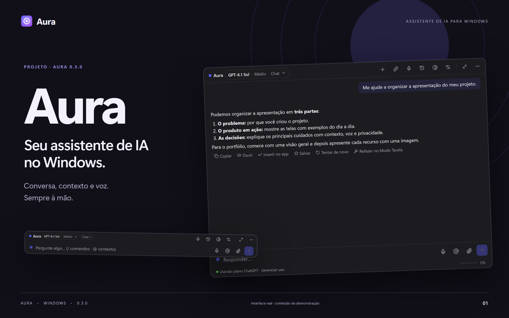

# Aura — portfólio e Instagram

Material visual da versão 0.3.0, produzido em 11/10/2026.

[**Baixar o pacote completo (ZIP)**](https://github.com/VIDORETTO/aura-windows/releases/download/v0.3.0/Aura_0.3.0_portfolio-instagram_2026-10-11.zip) · [Índice visual](indice-visual.png) · [Galeria HTML](galeria.html)

## Organização

| Pasta | Conteúdo | Formato |
| --- | --- | --- |
| [01-portfolio](01-portfolio/) | 36 composições horizontais | PNG, 2560 × 1600 px |
| [01-portfolio/webp](01-portfolio/webp/) | As mesmas 36 composições para o site | WebP, 2560 × 1600 px |
| [02-instagram](02-instagram/) | 20 imagens numeradas na sequência do carrossel | PNG, 2160 × 2700 px, 4:5 |
| [03-capturas-originais](03-capturas-originais/) | 63 telas, seções e painéis da interface | PNG em resolução 2× |
| [fontes](fontes/) | Layouts editáveis, logo, índices e scripts | HTML, SVG, JSON e JavaScript |

Os três arquivos `indice-*.png` permitem conferir o conjunto. Para navegar pela galeria interativa, baixe e extraia o ZIP e abra `galeria.html` no navegador; todos os arquivos usam referências relativas.

## Portfólio

Use as versões WebP no site e os PNG para edição.

| Ordem | Imagem | Arquivos |
| --- | --- | --- |
| 01 | Aura — apresentação | [PNG](01-portfolio/01-capa.png) · [WebP](01-portfolio/webp/01-capa.webp) |
| 02 | Conversa | [PNG](01-portfolio/02-conversa.png) · [WebP](01-portfolio/webp/02-conversa.webp) |
| 03 | Contexto | [PNG](01-portfolio/03-contexto.png) · [WebP](01-portfolio/webp/03-contexto.webp) |
| 04 | Modo Tarefa | [PNG](01-portfolio/04-tarefas.png) · [WebP](01-portfolio/webp/04-tarefas.webp) |
| 05 | Arquivos | [PNG](01-portfolio/05-arquivos.png) · [WebP](01-portfolio/webp/05-arquivos.webp) |
| 06 | Alterações | [PNG](01-portfolio/06-alteracoes.png) · [WebP](01-portfolio/webp/06-alteracoes.webp) |
| 07 | Histórico | [PNG](01-portfolio/07-historico.png) · [WebP](01-portfolio/webp/07-historico.webp) |
| 08 | Preparo de reunião | [PNG](01-portfolio/08-preparo.png) · [WebP](01-portfolio/webp/08-preparo.webp) |
| 09 | Reunião | [PNG](01-portfolio/09-reuniao.png) · [WebP](01-portfolio/webp/09-reuniao.webp) |
| 10 | Overlay compacto | [PNG](01-portfolio/10-overlay-compacto.png) · [WebP](01-portfolio/webp/10-overlay-compacto.webp) |
| 11 | Minibar | [PNG](01-portfolio/11-minibar.png) · [WebP](01-portfolio/webp/11-minibar.webp) |
| 12 | Geral | [PNG](01-portfolio/12-general.png) · [WebP](01-portfolio/webp/12-general.webp) |
| 13 | Conta e modelos | [PNG](01-portfolio/13-account.png) · [WebP](01-portfolio/webp/13-account.webp) |
| 14 | Provedores | [PNG](01-portfolio/14-providers.png) · [WebP](01-portfolio/webp/14-providers.webp) |
| 15 | Privacidade | [PNG](01-portfolio/15-privacy.png) · [WebP](01-portfolio/webp/15-privacy.webp) |
| 16 | Lembretes e notas | [PNG](01-portfolio/16-personal.png) · [WebP](01-portfolio/webp/16-personal.webp) |
| 17 | Voz | [PNG](01-portfolio/17-voice.png) · [WebP](01-portfolio/webp/17-voice.webp) |
| 18 | Extensões | [PNG](01-portfolio/18-extensions.png) · [WebP](01-portfolio/webp/18-extensions.webp) |
| 19 | Perfis de app | [PNG](01-portfolio/19-profiles.png) · [WebP](01-portfolio/webp/19-profiles.webp) |
| 20 | Atalhos | [PNG](01-portfolio/20-shortcuts.png) · [WebP](01-portfolio/webp/20-shortcuts.webp) |
| 21 | Diagnóstico | [PNG](01-portfolio/21-diagnostics.png) · [WebP](01-portfolio/webp/21-diagnostics.webp) |
| 22 | Sobre | [PNG](01-portfolio/22-about.png) · [WebP](01-portfolio/webp/22-about.webp) |
| 23 | Geral — instrucoes pessoais | [PNG](01-portfolio/23-general-instrucoes-pessoais.png) · [WebP](01-portfolio/webp/23-general-instrucoes-pessoais.webp) |
| 24 | Geral — memorias | [PNG](01-portfolio/24-general-memorias.png) · [WebP](01-portfolio/webp/24-general-memorias.webp) |
| 25 | Geral — modo yolo you only live once | [PNG](01-portfolio/25-general-modo-yolo-you-only-live-once.png) · [WebP](01-portfolio/webp/25-general-modo-yolo-you-only-live-once.webp) |
| 26 | Privacidade — janelas excluidas | [PNG](01-portfolio/26-privacy-janelas-excluidas.png) · [WebP](01-portfolio/webp/26-privacy-janelas-excluidas.webp) |
| 27 | Privacidade — retencao | [PNG](01-portfolio/27-privacy-retencao.png) · [WebP](01-portfolio/webp/27-privacy-retencao.webp) |
| 28 | Privacidade — gravacoes | [PNG](01-portfolio/28-privacy-gravacoes.png) · [WebP](01-portfolio/webp/28-privacy-gravacoes.webp) |
| 29 | Privacidade — registro de acesso | [PNG](01-portfolio/29-privacy-registro-de-acesso.png) · [WebP](01-portfolio/webp/29-privacy-registro-de-acesso.webp) |
| 30 | Lembretes e notas — textos salvos | [PNG](01-portfolio/30-personal-textos-salvos.png) · [WebP](01-portfolio/webp/30-personal-textos-salvos.webp) |
| 31 | Lembretes e notas — habitos | [PNG](01-portfolio/31-personal-habitos.png) · [WebP](01-portfolio/webp/31-personal-habitos.webp) |
| 32 | Voz — voz | [PNG](01-portfolio/32-voice-voz.png) · [WebP](01-portfolio/webp/32-voice-voz.webp) |
| 33 | Voz — leitura em voz alta | [PNG](01-portfolio/33-voice-leitura-em-voz-alta.png) · [WebP](01-portfolio/webp/33-voice-leitura-em-voz-alta.webp) |
| 34 | Extensões — comandos rapidos 1 | [PNG](01-portfolio/34-extensions-comandos-rapidos-1.png) · [WebP](01-portfolio/webp/34-extensions-comandos-rapidos-1.webp) |
| 35 | Extensões — comandos rapidos 2 | [PNG](01-portfolio/35-extensions-comandos-rapidos-2.png) · [WebP](01-portfolio/webp/35-extensions-comandos-rapidos-2.webp) |
| 36 | Extensões — comandos rapidos 3 | [PNG](01-portfolio/36-extensions-comandos-rapidos-3.png) · [WebP](01-portfolio/webp/36-extensions-comandos-rapidos-3.webp) |

[Ver todas as composições do portfólio](indice-portfolio.png).

## Carrossel do Instagram

A numeração dos arquivos define a ordem de publicação.

| Ordem | Imagem | Arquivos |
| --- | --- | --- |
| 01 | Aura — apresentação | [PNG](02-instagram/01-capa.png) |
| 02 | Conversa | [PNG](02-instagram/02-conversa.png) |
| 03 | Contexto | [PNG](02-instagram/03-contexto.png) |
| 04 | Modo Tarefa | [PNG](02-instagram/04-tarefas.png) |
| 05 | Arquivos | [PNG](02-instagram/05-arquivos.png) |
| 06 | Histórico | [PNG](02-instagram/06-historico.png) |
| 07 | Preparo de reunião | [PNG](02-instagram/07-preparo.png) |
| 08 | Reunião | [PNG](02-instagram/08-reuniao.png) |
| 09 | Geral | [PNG](02-instagram/09-general.png) |
| 10 | Conta e modelos | [PNG](02-instagram/10-account.png) |
| 11 | Provedores | [PNG](02-instagram/11-providers.png) |
| 12 | Privacidade | [PNG](02-instagram/12-privacy.png) |
| 13 | Lembretes e notas | [PNG](02-instagram/13-personal.png) |
| 14 | Voz | [PNG](02-instagram/14-voice.png) |
| 15 | Extensões | [PNG](02-instagram/15-extensions.png) |
| 16 | Perfis de app | [PNG](02-instagram/16-profiles.png) |
| 17 | Atalhos | [PNG](02-instagram/17-shortcuts.png) |
| 18 | Diagnóstico | [PNG](02-instagram/18-diagnostics.png) |
| 19 | Sobre | [PNG](02-instagram/19-about.png) |
| 20 | Overlay e Minibar | [PNG](02-instagram/20-overlay-e-minibar.png) |

[Ver todas as imagens do carrossel](indice-instagram.png).

## Origem das telas

As capturas foram renderizadas a partir dos componentes reais do Aura 0.3.0 na prévia local do projeto, com conteúdo de demonstração. Conta, conversas, provedores, notas, reuniões e estados técnicos são exemplos; não há credenciais reais. A ocultação de capturas do Aura impediu a captura direta das janelas de produção.

O conjunto inclui as 11 abas de configurações, conversa, contexto, Modo Tarefa, arquivos, alterações, histórico, preparo de reunião, reunião, Overlay compacto e Minibar. Páginas longas têm telas completas e capturas por seção.

## Fontes e integridade

[Como editar ou regenerar](fontes/README.md) · [Manifesto de capturas](manifesto.json) · [Verificação de dimensões e layout](fontes/verificacao.json) · [Hashes SHA-256](SHA256SUMS.txt)
