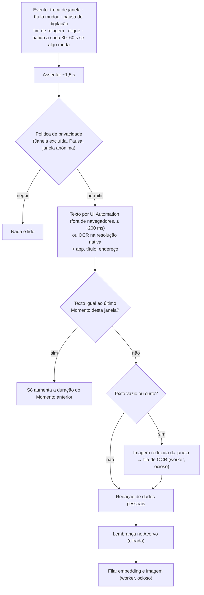

# Plano de produto — Segundo Cérebro

Data: 2026-11-12 · Status: **proposta** (não é spec; vira os candidatos CAND-073…083 em
`roadmap.md` e só vira esforço depois de passar pelo fluxo Hybrid) · Base:
`docs/research/segundo-cerebro.md` (pesquisa e fontes), `docs/qa/auditoria-codigo-2026-11-12.md`
(estado do código), `docs/HANDOFF.md`, `CONTEXT.md`, ADRs 0001–0011 (0012–0014 propostos),
`docs/research/segundo-cerebro-medicoes-2026-11.md` (medições, citado como [M §n]).

**Revisão 2 (2026-11-13).** Incorpora as medições preliminares de
`docs/research/segundo-cerebro-medicoes-2026-11.md` e propõe os ADRs 0012 a 0014. O que mudou está
no §13.

Os números de disco, CPU e latência deste plano são **estimativas de projeto**, exceto os marcados
como medidos. Esses vêm de protótipos fora do Aura, num desktop rápido. Os spikes do §9 continuam
necessários para trocar tudo por medições no código do Aura antes de qualquer promessa.

## 0. Resumo

**O pedido.** Um modo opcional em que o Aura lembra de tudo o que ajuda o usuário: reuniões,
artigos lidos, conversas com pessoas e com o próprio agente, o que passou pela tela. Pode gastar
mais disco e processamento. Vem pronto e se liga ao Obsidian sem a pessoa montar estrutura.

**O que a pesquisa mostrou.** Segundo cérebro falha por três motivos: manter custa mais do que
devolve, capturar tudo vira bagunça, e na hora de achar a pessoa não lembra que a nota existe. O
que funciona é o agente fazer a manutenção sozinho, a captura ser automática e a busca ser por
significado, tempo e pessoa.

**Cinco decisões deste plano**

1. **Motor próprio, embutido.** O índice (o **Acervo**) fica dentro do Aura: SQLite cifrado com
   FTS5 e vetores em tabela própria (binário + int8, ADR 0012 proposto), embeddings locais no
   worker (ADR 0014 proposto). Sem Docker, sem Python, sem servidor. RAGFlow e afins entram só
   como base externa opcional, por MCP (§3).
2. **Tela vira texto, não vídeo.** Em vez de foto a cada N segundos, o Aura registra
   **Momentos**: captura por evento; texto da janela por UI Automation fora dos navegadores, e
   OCR na resolução nativa nos navegadores e como reserva; descarte de repetidos; imagem com
   prazo de validade (§4, ADR 0013 proposto). A ideia de "tela parada por 5 segundos" está certa
   no gatilho e errada no que guarda; o §4.1 mostra o ajuste.
3. **O agente busca, não recebe despejo.** Ferramentas `memory_*` com busca híbrida, filtros de
   tempo, app, pessoa e projeto, e origem citada em toda resposta (§5).
4. **Consolidar enquanto a pessoa não está usando.** Um trabalho em segundo plano transforma
   Lembranças brutas em resumo do dia, **Fichas** de pessoas e projetos e Memórias (§6).
5. **Obsidian é vitrine e fonte, não motor.** O Aura escreve Markdown numa pasta própria do
   **Cofre de notas**, lê as notas da pessoa como mais uma fonte e nunca sobrescreve texto
   humano. Funciona com o Obsidian fechado e sem plugin (§7).

**Antes de tudo isso**, a auditoria achou um defeito que impede o modo de existir com segurança:
o modo Contínuo nunca apaga nada (A-01, confirmado em execução). A Fase 0 corrige isso.

**Ordem recomendada:** Fase 0 (correções e spikes) → Fase 1 (Acervo de texto com o que já
existe + Cofre de notas v0) → Fase 2 (Momentos de tela) → Fase 3 (Consolidação e Fichas) →
Fase 4 (Cofre completo, imagens, proativo) (§8).

**Decisões que dependem de você:** §10 (Q-011 a Q-017), todas com recomendação.

---

## 1. Onde o Aura está

### 1.1 Peças que já existem e que o plano reaproveita

| Já existe (onde) | Serve para |
| --- | --- |
| Política de privacidade, Janelas excluídas, Pausa, Registro de acesso (`aura-policy`, `privacy.rs`) | Decidir cada Momento **antes** de capturar; "o que o agente leu da minha memória" |
| Texto da janela por UI Automation com OCR de reserva (`read_screen_text`, `ScreenText`) | Fonte principal dos Momentos fora dos navegadores; precisa de orçamento de tempo (§4.2) |
| Redação de dados pessoais (`pii.rs`: CPF, CNPJ, cartão, telefone) | Limpar o texto antes de indexar |
| Cofre AES-GCM com chave por DPAPI, Segmentos cifrados (`aura-store::vault`) | Cifrar imagens e a chave do banco do Acervo |
| Motor de Reunião com Transcrição, Projetos, Compromissos (`meeting.rs`, `projects.rs`, `actions.rs`) | Reuniões entram no Acervo; Projetos viram Fichas |
| Notas e Salvos, lembretes (`notes.rs`, `reminders.rs`) | Entram no Acervo; a caixa de entrada vai para o Cofre de notas |
| Busca e leitura da web com histórico de fontes (`aura-web`, `web_history.rs`) | Páginas lidas pelo agente entram no Acervo; leitura completa de artigos |
| Worker sob demanda com ONNX (`aura-worker`, ADR 0005) | Embeddings e OCR em lote sem pesar no host |
| Catálogo e download verificado de modelos (`aura-asr/catalog.rs`, `download.rs`) | Baixar o modelo de embeddings do mesmo jeito que os de voz |
| Instruções agendadas (esforço 030) | Disparar a Consolidação |
| Chips de origem (reuniões) e fontes W1 (web) | Padrão visual das citações de memória |
| Servidor MCP do Aura e gerenciador de servidores MCP | Ferramentas `memory_*`; bases externas pré-configuradas |
| Ingestão de anexos (PDF, planilhas, documentos, áudio, vídeo) | Arquivos entram no Acervo com o mesmo conversor |

### 1.2 O que não existe

| Falta | Hoje |
| --- | --- |
| Índice de busca | Não há FTS5 nem vetores; notas e reuniões são varridas inteiras (A-05) |
| Memória de tela de longo prazo | Só vídeo H.264 a 1 fps, sem texto associado; o agente recebe até 8 quadros dos últimos 30 min |
| Lembrar de Conversas | Sem busca entre Conversas; Memória do Codex desligada por padrão (A-10) |
| "Que artigo era aquele?" | Nada guarda endereço, título e texto do que foi lido |
| Pessoas | Reunião só distingue "Você" e "Eles" |
| Ligação com Obsidian ou qualquer pasta de notas | Nada |
| Retenção confiável em gravação longa | A-01, A-03, A-04 |

---

## 2. Vocabulário proposto

Entram em `CONTEXT.md` quando o primeiro esforço for especificado. "Memória" já existe e
continua significando o fato durável.

| Termo | Definição | Evitar |
| --- | --- | --- |
| **Segundo Cérebro** | Modo opcional em que o Aura guarda e indexa o que o usuário vê, ouve e conversa, para lembrar depois. | modo memória (confunde com Memória), recall |
| **Acervo** | Índice local e cifrado de todas as Lembranças. | base de conhecimento, banco vetorial |
| **Lembrança** | Unidade do Acervo: um Momento, um trecho de Reunião, um Turno, uma nota, uma página lida, um trecho de arquivo. Tem origem, hora e texto. | registro (reservado para Registro de acesso), chunk |
| **Momento** | Lembrança de tela: aplicativo, janela, endereço, texto visível, início e duração, com imagem opcional. | screenshot, snapshot, frame |
| **Consolidação** | Trabalho em segundo plano que destila Lembranças em resumos, Fichas e Memórias. | sumarização, pipeline |
| **Ficha** | Página sobre uma Pessoa, um Projeto ou um Tópico, com fatos datados e origem citada. | entidade, perfil (reservado para Perfil de aplicativo) |
| **Cofre de notas** | Pasta de arquivos Markdown, compatível com Obsidian, onde o Aura publica o que destilou e de onde lê as notas do usuário. | vault, cofre (sozinho: confunde com o cofre de Credenciais) |

---

## 3. Fazer ou integrar

| Opção | Veredito | Motivo |
| --- | --- | --- |
| **Motor próprio embutido** (SQLite FTS5 + vetores em BLOB + embeddings no worker) | **Adotar** | Único caminho que respeita leveza, instalação sem administrador, licenças permissivas, cifra em repouso e Política aplicada na captura. Zero configuração para o usuário. |
| RAGFlow como motor | Rejeitar | Docker, cinco serviços, ~16 GB de RAM. Público de servidor, não de desktop. |
| Código do screenpipe | Rejeitar | Licença comercial/source-available. Ficam as ideias. |
| Mem0, Zep, Letta como dependência | Rejeitar | São serviços; os benchmarks publicados se contradizem (93,4 autodeclarado contra 49,0 independente para o mesmo produto). Ficam as ideias: extrair e consolidar fatos, fatos com validade no tempo. |
| Plugin do Obsidian como motor | Rejeitar | Exige o Obsidian aberto e amarra a memória a um app de terceiros. |
| **Obsidian como destino e fonte** (pasta Markdown) | **Adotar** | Formato aberto, dados portáveis, a pessoa enxerga e edita. Responde à dor "o fornecedor some". |
| **Bases externas por MCP** (RAGFlow, Khoj, AnythingLLM, Notion…) | **Oferecer como opcional** | Para quem já tem uma. Entram como modelos prontos no gerenciador de servidores MCP; o Aura não instala nem mantém. |
| **Aura como servidor MCP só de leitura** (CAND-049) | Adotar depois | Outros agentes consultam o Acervo. |

Regra geral: **o usuário comum não instala nada além do Aura**. Tudo o que é módulo externo é
para quem já sabe o que quer.

---

## 4. Momentos de tela: capturar barato

### 4.1 A ideia dos 5 segundos

"Tela parada por 5 s → tira um print" acerta em esperar a tela assentar. O peso vem de três
coisas que a regra não diz:

1. **Guarda imagem inteira.** Um PNG de monitor cheio tem de centenas de KB a alguns MB. Com
   centenas ou milhares de paradas por dia, são de 0,5 a mais de 2 GB por dia.
2. **Não compara com o anterior.** Ler um documento parado gera a mesma foto várias vezes.
3. **Olha o relógio, não o que aconteceu.** Vigiar "parou há 5 s?" exige comparar quadros o
   tempo todo.

O ajuste mantém a intuição e muda o resto:

| Ideia original | Desenho proposto |
| --- | --- |
| Vigiar a tela até parar | Esperar **eventos** (troca de janela, de título, pausa de digitação, fim de rolagem) e capturar ~1,5 s depois do último |
| Sempre guardar | Guardar só se o **texto ou a imagem mudou** em relação ao último Momento da mesma janela |
| Guardar a foto | Guardar o **texto** (pequeno, pesquisável) e uma imagem reduzida só da janela ativa |
| Para sempre | Texto fica; imagem **vence** e é rareada |

### 4.2 Funil de captura



Pontos do desenho:

- **Gatilhos por evento.** No Windows, `SetWinEventHook` avisa troca de primeiro plano e de
  título sem sondagem. São dois ganchos separados, nunca uma faixa de eventos: cada evento
  assinado custa ~0,19 ms a quem o dispara, e a faixa larga ainda encarece os eventos não
  assinados (medido, [M §4.3]). Pausa de digitação sai do gancho de teclado que o Aura já tem
  para atalhos; fim de rolagem e clique pedem um gancho de mouse novo. A batida de 30–60 s cobre
  vídeo e apresentações.
- **Nada acontece com o usuário ausente.** Sem entrada há mais de alguns minutos, tela
  bloqueada, jogo ou vídeo em tela cheia: sem captura.
- **Texto primeiro, mas não a qualquer custo.** Fora dos navegadores, a UI Automation devolve o
  texto exato da janela, sem modelo. A leitura **não é barata**: o algoritmo atual levou 2,6 s no
  WhatsApp e 1,4 s de p95 no Word (medido, [M §4.2]). Por isso ela tem orçamento de ~200 ms e,
  passando disso, cai para OCR.
- **Navegadores e apps Chromium/Electron/WebView2 por OCR.** Uma única leitura do Chrome por UIA
  liga a acessibilidade completa dele. Numa página muito dinâmica, cada tecla passou a levar
  ~12 s (medido, [M §4.5]). Esses apps vão por captura da janela + OCR do Windows; título e
  endereço vêm do título da janela. UIA nesses apps só como opção explícita, com aviso.
- **OCR na resolução nativa.** O OCR (`Windows.Media.Ocr`, já adaptado) roda sobre a captura
  antes de reduzir. Reduzir de 1.920 para 1.280 px derruba o reconhecimento de código para 24%
  (medido, [M §5]).
- **Dois filtros de repetição.** Impressão digital do texto normalizado (igual → descarta) e
  "nada mudou na tela". No build 26100+, este segundo vem do Windows.Graphics.Capture por janela,
  que só entrega quadro quando algo muda e informa o retângulo alterado (medido, [M §6]). Em
  builds anteriores, hash perceptual da imagem reduzida. Com os dois, rolar um documento gera
  Momentos novos; ficar parado lendo, não.
- **Trabalho pesado fora do host.** O host só lê texto e calcula hashes. OCR em lote,
  embeddings e compressão de imagem rodam no `aura-worker`, com a máquina ociosa e na tomada.
  Nos navegadores o texto só existe depois do OCR. Até lá, o Momento guarda a captura nativa (WebP
  sem perdas, ~45 KB), e a repetição é decidida pelo WGC e pelo título. Por isso o OCR desses
  Momentos não pode esperar dias: ele precisa de um teto de fila, a medir no S3.
- **Um Momento tem duração.** "Fiquei 12 minutos nesta página" é o sinal mais útil de
  importância e sai de graça do filtro de repetição.

O WGC deixa de ser "otimização posterior": a medição mostrou que ele responde "mudou algo?" de
graça (ADR 0013 proposto). O GDI do ADR 0008 continua como reserva para builds anteriores ao
26100 e para captura de monitor inteiro.

[M] = `docs/research/segundo-cerebro-medicoes-2026-11.md`.

### 4.3 O que cada camada guarda

| Camada | Conteúdo | Tamanho estimado | Prazo padrão |
| --- | --- | --- | --- |
| **Texto** | App, título, endereço, início, duração, texto redigido, embedding | ~100–150 MB por mês de uso (texto + índice + vetores binário e int8, 432 bytes por trecho) | Sem prazo, até o teto |
| **Imagem** | Janela ativa na resolução nativa, WebP sem perdas para telas de texto (OCR antes de qualquer redução), cifrada pelo cofre; miniatura reduzida opcional | ~45 KB cada em telas de texto (medido: 44 KB médios a 1.280 × 1.080, [M §5]); até ~800 por dia → ~1,1 GB por mês antes de rarear (calculado). Telas com foto ou vídeo ficam maiores sem perdas: para elas, WebP com perdas (q75) | 30 dias inteira; depois 1 por Momento longo; depois de 90 dias só as citadas ou fixadas |
| **Vídeo** | O Buffer recente de hoje (H.264, Segmentos) | Como hoje | Como hoje: minutos |

O vídeo contínuo deixa de ser o caminho da memória longa. O Buffer recente continua servindo
para "o que acabou de acontecer" e para o "esqueci de iniciar" da Reunião.

### 4.4 Predefinições

| Predefinição | Tela | Áudio | Teto de disco sugerido |
| --- | --- | --- | --- |
| **Econômico** | Só texto | Só Transcrição de Reuniões iniciadas pelo usuário | 2 GB |
| **Equilibrado** (recomendado) | Texto + imagem por 30 dias | Transcrição de Reuniões; áudio apagado ao encerrar | 10 GB |
| **Completo** | Texto + imagem por 90 dias | Transcrição contínua do áudio do sistema, opt-in à parte | 50 GB |

Atingido o teto, o Acervo apaga primeiro imagens antigas, depois texto antigo, e avisa. É o
modelo do Recall (teto proporcional, o mais antigo sai primeiro).

### 4.5 Privacidade dos Momentos

- **Desligado por padrão**, ligado numa tela própria que mostra exatamente o que será guardado.
- Indicador na bandeja e no Overlay enquanto o Segundo Cérebro está ativo.
- Excluídos de fábrica, além das Janelas excluídas atuais: janelas anônimas de navegador,
  campos de senha (propriedade `IsPassword` da UIA), gerenciadores de senha, apps de banco.
  Janela anônima: o Edge marca "[InPrivate]" no título; o título da janela anônima do Chrome é
  igual ao normal, e só o nome UIA da raiz traz "(Modo anônimo)", traduzido conforme o idioma.
  O `IS_PRIVATE` que o Recall usa não é legível por outro processo (medido e pesquisado,
  [M §4.4, §8.1]). O S3 confirma se ler só esse nome liga a acessibilidade do Chrome. Na dúvida,
  não capturar.
- **Esquecer** em um clique: os últimos N minutos, um dia, um aplicativo, um site, uma pessoa.
  Apagar remove texto, imagem, vetor e o que a Consolidação derivou daquilo.
- Conversa efêmera nunca entra no Acervo.
- Todo acesso do agente ao Acervo passa pela Política (nova Permissão do agente para a fonte
  Acervo: Nunca, Perguntar, Sempre) e fica no Registro de acesso.
- Conversas com terceiros (chat, e-mail, reunião) envolvem dados de outras pessoas. Antes de
  prometer "lembra das conversas com clientes" na interface, precisamos de orientação jurídica
  (LGPD); a pesquisa não achou base para afirmar nada (§9, S6).

---

## 5. O Acervo e a recuperação

### 5.1 Fontes

| Fonte | Lembrança | Fase |
| --- | --- | --- |
| Conversas com o agente | Cada Turno concluído (pedido + resposta final, sem ruído de ferramentas) e um resumo por Conversa | 1 |
| Reuniões | Trechos de fala de 30–60 s com orador, título e Projeto | 1 |
| Notas, Salvos, Compromissos | Um item cada | 1 |
| Páginas lidas pelo agente (`web_fetch`) | Trechos com endereço | 1 |
| Anexos | Trechos por página, aba ou seção | 1 |
| Cofre de notas do usuário | Trechos por título de seção | 1 |
| Tela | Momentos | 2 |
| Páginas lidas pelo usuário | Momento de navegador com endereço e duração; texto completo do artigo quando a leitura passa de um limite | 2–4 |
| Histórico do navegador (importação) | Endereço, título e data, para o Acervo não começar vazio | 4 |

### 5.2 Armazenamento

- Banco próprio, `memory.db`, separado do `aura.db`: cresce muito mais, tem retenção própria e
  pode ser apagado inteiro sem tocar nas configurações.
- **Cifrado por inteiro.** O FTS5 não funciona sobre campos cifrados um a um, e um índice de
  tudo o que a pessoa viu não pode ficar em claro (foi a crítica central ao Recall). Proposta:
  SQLCipher com a chave guardada pelo cofre existente (DPAPI). Compila no MSVC com
  `bundled-sqlcipher-vendored-openssl`, desde que o build tenha Perl nativo do Windows (medido,
  [M §3.1]).
- Tabelas: `lembrancas` (origem, tipo, hora, duração, app, endereço, pessoa, projeto, texto),
  FTS5 com `unicode61 remove_diacritics 2` (aposenta o `fold` manual de `notes.rs`), `vetores`
  (tabela comum em ordem de inserção: binário de 48 bytes + int8 de 384 bytes por trecho, sem
  float32), `imagens` (ponteiro para arquivo cifrado), `fatos` (§6). Sem sqlite-vec por padrão
  (ADR 0012, aceito com o S2).
- Busca vetorial no worker: filtro de período como faixa de `rowid` (com a data conferida por
  linha) → varredura do binário em Rust → reordenação dos 200 melhores pelo int8. O host é o único
  escritor; o worker lê com cache dimensionado (~74 MB por milhão). A ~2.000 trechos por dia útil
  são ~500 mil por ano. Medido no S2 (`specs/046-spikes-segundo-cerebro/s2.md`) com SQLCipher e
  vetores reais do bekko-a8m em português: com 200 candidatos, 1 milhão sem filtro leva 70 ms de
  p95 num desktop e 104 ms numa aproximação de máquina modesta; os últimos 30 dias, menos de
  17 ms; recall@10 de 0,90. Com o cache padrão de 2 MB, passa de 300 ms a partir de 500 mil.

### 5.3 Como o agente lembra

O agente recebe ferramentas e decide quando usar; nada é despejado no contexto a cada Turno.

| Ferramenta | Faz |
| --- | --- |
| `memory_search` | Busca híbrida. Filtros: período, fonte, aplicativo, site, pessoa, projeto. Devolve trechos com id, origem e hora. |
| `memory_timeline` | O que aconteceu entre dois instantes, agrupado por sessão de trabalho. |
| `memory_get` | Uma Lembrança inteira e as vizinhas no tempo. |
| `memory_image` | A imagem de um Momento, entregue ao modelo como imagem. |
| `person_get`, `project_get` | A Ficha, com fatos e origens. |

Receita de recuperação:

1. **Contexto no trecho, sem LLM.** Cada trecho é indexado com um cabeçalho montado por regra:
   data, aplicativo, título, endereço, reunião, orador. É a versão barata da recuperação
   contextual; a medição da Anthropic dá ~35% menos falhas só com isso sobre embeddings simples.
   Contexto gerado por LLM fica só para documentos longos, e opcional.
2. **Duas buscas, uma fusão.** FTS5 (BM25) pega nomes, códigos e termos exatos. Vetores pegam
   paráfrase ("aquele artigo sobre preço de energia"). **Fusão por posição recíproca (k = 60) com
   pesos iguais**, como decidido no S1 (ADR 0014). Ela melhorou o MRR de todos os modelos em
   +0,06 a +0,09 num conjunto de 240 documentos e 100 perguntas; peso menor no lexical piorou.
   A revisão 2 tinha proposto o contrário com base num conjunto pequeno e enviesado [M §2]; o S1
   reverteu.
3. **Filtros antes de ranquear.** "Semana passada", "com a Ana", "no Chrome" viram filtros. O
   agente já tem `clock_now`.
4. **Recência e duração como desempate.** Não como critério principal.
5. **Reordenação** só se o conjunto dourado mostrar ganho que pague a latência.
6. **Origem sempre.** Toda afirmação tirada do Acervo sai com chip de origem (reunião e minuto,
   página e data, Conversa e Turno), no padrão que reuniões e web já usam.

### 5.4 Imagens

Três níveis, do mais barato ao mais caro:

1. **Achar pelo texto.** O texto de UIA ou OCR do Momento é indexado como qualquer outro. Cobre
   a maior parte dos casos, porque tela é quase sempre texto.
2. **Entender com o modelo.** Achado o Momento, `memory_image` entrega a imagem ao modelo
   multimodal da Conversa. Recuperar por texto e interpretar por visão dá qualidade alta sem
   índice visual.
3. **Achar pela aparência** (Fase 4, opcional): embedding visual de vetor único para pedidos
   como "o gráfico de barras azul". ColPali e similares ficam de fora: muitos vetores por
   imagem e evidência contraditória contra OCR.

### 5.5 Lembrar das Conversas

1. Ao fim de cada Turno, pedido e resposta final viram Lembranças ligadas à Conversa.
2. Com a máquina ociosa, cada Conversa encerrada ganha título, resumo de cinco linhas e lista
   de decisões e fatos. O resumo também é indexado: perguntas vagas batem no resumo, perguntas
   precisas batem no Turno.
3. Fatos duráveis sobre o usuário viram propostas de Memória, com quatro saídas possíveis:
   acrescentar, atualizar, invalidar, ignorar. Fato contradito não é apagado: ganha data de fim
   e aponta para o que o substituiu. A tela de revisão de Memórias que já existe mostra e
   desfaz.
4. Um perfil curto (poucas centenas de tokens) vai em toda Conversa nova. O resto o agente
   busca.

### 5.6 Como saber se está bom

Sem medição própria, escolha de modelo e de receita é palpite; os benchmarks dos fornecedores
se contradizem. Proposta: um **conjunto dourado** em português, com perguntas reais sobre
reuniões, telas, notas e conversas sintéticas, e a resposta esperada apontando a Lembrança
certa. Entra no `aura-bench` com acerto nos 10 primeiros, posição média e latência. Toda
mudança de modelo, corte de trecho ou fusão roda contra ele.

---

## 6. Consolidação

Roda com a máquina ociosa e na tomada, disparada pelas Instruções agendadas.

| Produto | Quando | Com LLM? |
| --- | --- | --- |
| **Sessões de trabalho**: Momentos vizinhos do mesmo assunto agrupados | Contínuo | Não (tempo, app, endereço) |
| **Linha do tempo do dia** | Fim do dia | Não |
| **Resumo do dia**: o que foi feito, decidido, lido e prometido | Fim do dia | Sim |
| **Fichas** de Pessoa, Projeto e Tópico: fatos datados com origem | Após reuniões e no fim do dia | Sim |
| **Propostas de Memória** | Após Conversas | Sim |
| **Revisão semanal**: Fichas quase duplicadas, fatos vencidos, contradições, ligações quebradas | Semanal | Sim; vira um cartão para aprovar, nada é corrigido em silêncio |

Regras tiradas das falhas relatadas no padrão LLM-wiki:

- O bruto é imutável. A Consolidação só escreve no destilado.
- Todo fato guarda o id das Lembranças de origem. Fato sem origem não é gravado.
- Antes de criar uma Ficha, buscar por nome parecido; em dúvida, perguntar ("Ana Souza e Ana S.
  são a mesma pessoa?").
- Decidir **onde** escrever é regra, não LLM (um implementador mediu ~72% dos tokens indo para
  essa decisão). O LLM só destila.
- Teto diário de tokens para trabalho em segundo plano, visível e ajustável, com modelo barato
  por padrão.
- Sem LLM disponível, a linha do tempo e as sessões continuam funcionando.

**Conflito com a visão.** `docs/project/vision.md` diz: "Nenhum dado capturado sai da máquina
fora de um turno do usuário ou de uma ferramenta permitida pela política". Resumir o dia com um
modelo em nuvem é exatamente dado capturado saindo fora de um Turno. A Consolidação com
provedor em nuvem precisa de consentimento próprio, de uma entrada na Política (Desligada, Só
local, Com o provedor escolhido) e de uma revisão da visão. É a Q-013.

---

## 7. Cofre de notas e Obsidian

### 7.1 Princípios

1. **Um clique.** "Criar meu Cofre de notas" cria a pasta pronta. Quem já tem um cofre no
   Obsidian aponta para ele e o Aura cria só a subpasta `Aura/`.
2. **O Aura só escreve no que é dele.** Dentro de `Aura/`, em arquivos com `gerado_por: aura`,
   e dentro de blocos marcados. Texto que a pessoa escrever fora dos blocos nunca é tocado.
3. **Nunca sobrescrever em silêncio.** Se a pessoa editou um bloco do Aura, a atualização vira
   sugestão ao lado, não substituição.
4. **Sem plugin e sem o Obsidian aberto.** Escrita direta na pasta, com arquivo temporário e
   renomeação. Abrir uma nota usa o endereço `obsidian://`. A CLI oficial (1.12, precisa do app
   aberto) é atalho opcional.
5. **Só o destilado vai para o Cofre.** Resumos, reuniões, Fichas, fontes lidas. O texto bruto
   da tela nunca é exportado.
6. **Aviso claro:** o Cofre é texto em claro, fora da cifra do Aura. Se a pasta estiver em
   OneDrive, Obsidian Sync ou git, o conteúdo vai para lá. A pessoa escolhe o que publicar.

### 7.2 Estrutura pronta

```
<Cofre>/Aura/
  LEIA-ME.md                      regras da pasta e como o Aura a mantém
  Caixa de entrada.md             notas rápidas (/anota)
  Diário/2026/2026-11-12.md       resumo do dia, linha do tempo, ligações
  Reuniões/2026-11-12 Kickoff ACME.md
  Pessoas/Ana Souza.md
  Projetos/ACME.md
  Tópicos/Precificação.md
  Fontes/2026-11 Artigo sobre X.md    página lida: endereço, resumo, trechos
  _aura/index.md                  catálogo de páginas
  _aura/log.md                    histórico só de acréscimo do que o Aura fez
```

Poucas pastas fixas, sem método para escolher. Cada nota tem propriedades (`tipo`, `data`,
`pessoas`, `projeto`, `fonte`, `aura_id`, `gerado_por`, `atualizado`) e ligações `[[…]]` entre
reunião, pessoas e projeto. Com isso o grafo, os backlinks, o Bases e o Dataview funcionam sem a
pessoa configurar nada.

### 7.3 Ler o Cofre

O Aura vigia a pasta que a pessoa indicar e indexa as notas dela como mais uma fonte do Acervo
(trechos por título de seção, com as propriedades como filtros). O agente responde citando
`[[nota]]`. Pastas podem ser excluídas. É a resposta à dor "tenho as notas e não acho".

### 7.4 Outros destinos

A mesma pasta serve a qualquer editor de Markdown. Notion, Logseq e afins entram depois, como
servidores MCP, sem mudar o desenho.

---

## 8. Fases

Cada fase termina em algo que dá para demonstrar.

### Fase 0 — Chão firme

- Corrigir A-01 (retenção do Contínuo), A-02 (gravador que morre calado), A-03 e A-04
  (retenção velha e custo por Segmento). → **CAND-083**
- Spikes S1 a S4 (§9).
- ADRs propostos (§11) aceitos ou recusados.
- **Demonstração:** teste que falha hoje com um Segmento `continuous` passa; relatório dos
  spikes com números.

### Fase 1 — O Aura lembra do que já tem

- Acervo com FTS5 e vetores sobre Conversas, Reuniões, notas, anexos e páginas lidas pelo
  agente. → **CAND-073**
- Memória de Conversas: resumo por Conversa, busca entre Conversas. → **CAND-074**
- Página "Memória": buscar, ver origem, esquecer, ver uso de disco. → **CAND-076**
- Cofre de notas v0: criar a pasta, publicar reuniões e notas, indexar o cofre do usuário.
  → **CAND-078** (primeira fatia)
- Conjunto dourado no `aura-bench`.
- **Demonstração:** "o que combinamos sobre o orçamento em outubro?" responde citando reunião e
  Conversa; a nota da reunião aparece no Obsidian.

Nada nesta fase captura algo novo. Entrega valor só com dados que o Aura já guarda e pode ser
ligada sem a conversa de privacidade da tela.

### Fase 2 — Momentos de tela

- Captura por evento, texto primeiro, filtro de repetição, camadas e teto. → **CAND-075**
  (absorve CAND-015)
- "O que eu li": Momentos de navegador com endereço e duração. → **CAND-079** (primeira fatia)
- Predefinições, indicador, exclusões novas, Esquecer.
- **Demonstração:** depois de um dia de uso, "qual era aquele artigo sobre X que li ontem?"
  devolve o endereço; relatório de CPU, RAM e disco do dia contra os orçamentos do §8.1.

### Fase 3 — Consolidação

- Sessões, linha do tempo, resumo do dia, Fichas, propostas de Memória, revisão semanal.
  → **CAND-077**
- Política e consentimento da Consolidação em nuvem.
- **Demonstração:** "o que eu sei sobre a Ana?" abre a Ficha com fatos datados e origens; o
  resumo de ontem está no Diário.

### Fase 4 — Completar

- Cofre completo: Diário, Pessoas, Projetos, Fontes, blocos gerenciados, conflitos.
  → **CAND-078**
- Texto completo de artigos e importação do histórico do navegador. → **CAND-079**
- Imagens: `memory_image` e busca por aparência. → **CAND-080**
- Proativo: resumo antes da reunião, "Onde eu parei?" sobre o Acervo, lembrar o que é
  relacionado ao que está na tela. → **CAND-081** (liga com CAND-041)
- Bases externas por MCP e Aura como servidor MCP. → **CAND-082**, CAND-049
- Quem falou (CAND-043) alimenta as Fichas de Pessoa.

### 8.1 Orçamentos propostos com o Segundo Cérebro ligado

Os orçamentos atuais (ocioso ≤ 150 MB, CPU ≤ 0,5%) valem com capturas desligadas e não mudam.

| Métrica | Orçamento proposto | Onde se mede |
| --- | --- | --- |
| CPU do host com captura de Momentos | ≤ 1% de **um núcleo** em média num dia de trabalho (ganchos + UIA a cada evento, sem agrupar, mediram 1,75% de um núcleo em uso sintético, [M §4.2]; o agrupamento de 1,5 s e a exclusão dos navegadores devem trazer para baixo disso) | `aura-bench`, Fase 2 |
| Memória a mais no host | ≤ 40 MB | idem |
| Trabalho do worker (OCR, embeddings) | Só com a máquina ociosa e na tomada; nunca durante Reunião ou tela cheia | idem |
| `memory_search` | ≤ 300 ms p95 com 500 mil trechos, busca vetorial no worker (S2, só a parte vetorial: 39 ms de p95 num desktop e 59 ms na aproximação de máquina modesta, sem filtro) | `aura-bench memory`, busca completa, Fase 1 (047 AC-011) |
| Disco | Dentro do teto da predefinição; nunca cresce sem limite | teste de retenção |

---

## 9. Spikes

| ID | Pergunta | Como | Fase |
| --- | --- | --- | --- |
| S1 | Qual modelo de embeddings em português? | Finalistas (ADR 0014): granite-97m-r2, bekko-a25m int8, bekko-a8m; e5-small como base. Conjunto dourado com 50–100 perguntas **escritas pelo usuário** sobre documentos parecidos com os reais (só local): acerto na 1ª e nos 10 primeiros, MRR, latência, RAM no worker em Rust; fusão vetor + FTS5 com pesos diferentes; Bekko também com OpenVINO. Já adiantado em conjunto sintético ([M §2]) | 0 |
| S2 | O desenho do ADR 0012 cumpre ≤ 300 ms p95 num notebook modesto? | Compilação MSVC + SQLCipher já confirmada ([M §3.1]). Falta: implementar binário + int8 em BLOB no `aura-store`/worker, medir num notebook modesto com 500 mil e 1 milhão de vetores do modelo do S1, ajustar o número de candidatos pelo recall, decidir worker residente ou partida a frio, medir o tempo de CI com Perl | 0 |
| S3 | Quanto custa capturar por evento, no desenho do ADR 0013? | Já medido em uso sintético ([M §4]). Falta: um dia de **uso humano real** (só contagens), Teams, leitura UIA com orçamento e navegadores por OCR; se ler só o nome UIA da raiz liga a acessibilidade do Chrome; quanto tempo o Chrome leva para desligá-la; notebook modesto | 0 (exige Windows) |
| S4 | OCR na resolução nativa e WGC como gatilho funcionam em telas reais? | Formato já medido em páginas públicas ([M §5]: WebP sem perdas, OCR antes de reduzir; [M §6]: WGC). Falta: confirmar em telas reais variadas (planilha, PDF, vídeo, tema escuro) e prototipar o gatilho WGC no `aura-win` | 0 |
| S5 | Quanto custa a Consolidação? | Tokens por dia de uso real com modelo barato; qualidade do resumo julgada por você | 3 |
| S6 | O que a LGPD exige para guardar conversas com terceiros? | Orientação jurídica | antes da Fase 2 |

S3 depende da validação de UIA e OCR que o HANDOFF lista como pendente desde setembro.

---

## 10. Decisões que dependem de você

| ID | Pergunta | Recomendação |
| --- | --- | --- |
| Q-011 | Motor próprio embutido, com bases externas só como opcional? | **Sim.** É o que mantém "instalou, funciona". |
| Q-012 | O Acervo vai num banco separado e cifrado por inteiro (SQLCipher)? | **Sim; confirmado pelo S2 em 13/11/2026** (ADR 0012 aceito). Texto de tudo o que a pessoa viu não pode ficar em claro. |
| Q-013 | A Consolidação pode enviar Lembranças a um provedor em nuvem fora de um Turno? | **Sim, com consentimento próprio e desligada por padrão.** Exige revisar a restrição da visão. A linha do tempo sem LLM funciona de qualquer jeito. |
| Q-014 | Qual predefinição vem marcada ao ligar? | **Equilibrado** (texto + imagem por 30 dias, teto de 10 GB). |
| Q-015 | A Fase 1 (sem captura nova) sai antes dos Momentos de tela? | **Sim.** Entrega "lembra das reuniões e conversas" cedo e deixa a parte sensível para depois dos spikes. |
| Q-016 | O Cofre de notas publica só o destilado? | **Sim.** Texto bruto de tela em pasta sincronizada é o pior caso de vazamento. |
| Q-017 | Arrumar a documentação de processo (A-11, A-12) antes de abrir os esforços novos? | **Decidido em 13/11/2026 (delegado pelo usuário): sim, passada curta e sem evidência retroativa.** A-12: `overview.md` alinhado aos ADRs. A-11: não se registra evidência de esforço antigo sem rodar os aceites; vira CAND-084 (P2) e não bloqueia os esforços novos, que não dependem do estado dos esforços 012–035. |

---

## 11. ADRs a propor

Decisões difíceis de reverter. 0012 a 0014 já foram escritos com status "proposed" em
13/11/2026, a partir das medições; viram "accepted" depois dos spikes S1 a S3 oficiais. 0015 e
0016 viram ADR no primeiro esforço que os tocar.

| ADR | Decisão |
| --- | --- |
| 0012 | Acervo em banco próprio (`memory.db`) cifrado por inteiro, com FTS5 e vetores em BLOB (binário + int8), busca no worker — **escrito como proposto**: `docs/adr/0012-acervo-cifrado-com-vetores-em-blob.md` |
| 0013 | Memória de tela por Momentos (evento, texto fora dos navegadores, OCR na resolução nativa, WGC como gatilho); complementa os ADRs 0004 e 0008 — **escrito como proposto**: `docs/adr/0013-momentos-de-tela-por-evento.md` |
| 0014 | Embeddings locais no worker com bekko-a8m (e5-small de reserva) e busca híbrida por RRF de pesos iguais; nuvem só como opção — **aceito** em 13/11/2026 após o S1: `docs/adr/0014-embeddings-locais-no-worker.md` |
| 0015 | Cofre de notas: Markdown em pasta própria, escrita direta, blocos gerenciados |
| 0016 | Consolidação em segundo plano e saída de dados fora de um Turno (revisa a visão) |

---

## 12. Riscos

| Risco | Mitigação |
| --- | --- |
| Reação de privacidade como a do Recall | Desligado por padrão, indicador, banco cifrado, Esquecer, exclusões de fábrica, tudo local |
| UIA devolve pouco texto em apps importantes | S3 mede antes; OCR de reserva; lista de apps com tratamento próprio |
| Ler um navegador por UIA liga a acessibilidade completa dele e trava a digitação em páginas dinâmicas (medido, [M §4.5]) | Navegadores e apps Chromium/Electron por OCR; UIA com orçamento de tempo; S3 confirma em uso real |
| SQLCipher deixa a busca vetorial 5–10× mais lenta (medido, [M §3.4]) | Filtro de período por faixa de `rowid`, cache dimensionado no worker (ADR 0012); S2 num notebook modesto |
| Embeddings fracos em português | S1 com conjunto dourado; FTS5 segura nomes e termos exatos; finalistas já superam o e5-small em paráfrase (medido, [M §2]) |
| Consolidação gasta o plano do usuário | Teto diário visível, modelo barato, só ociosa, funciona sem LLM |
| Fichas duplicadas ou erradas | Origem obrigatória, pergunta em caso de dúvida, revisão semanal com aprovação |
| Disco cheio | Teto por predefinição e retenção corrigida na Fase 0 |
| Dados de terceiros | S6 antes de prometer; consentimento de Reunião que já existe |
| Escopo grande demais | Fases com demonstração; a Fase 1 vale sozinha |

---

## 13. Revisões

### Revisão 2 — 2026-11-13

Medições preliminares em `docs/research/segundo-cerebro-medicoes-2026-11.md` (Ryzen 7 7800X3D,
Windows 11 build 26200, protótipos fora do Aura) e propostas I-1 a I-31 (complemento §10 e
medições §9). Mudanças nesta revisão:

| Trecho | Antes | Agora | Origem |
| --- | --- | --- | --- |
| §0, §3, §5.2 | FTS5 + sqlite-vec, vetores de 8 bits, binário só "se o p95 passar" | Vetores em BLOB (binário + int8), filtro de período por `rowid`, busca no worker; sqlite-vec opcional | I-2, I-3, I-21, I-22, I-24; ADR 0012 |
| §5.2 | Compatibilidade com o MSVC em aberto | Compila; exige Perl nativo no build | I-23 |
| §5.3 (2) | Fusão por posição recíproca | Sem RRF de pesos iguais; peso do lexical sai do S1 | I-19 |
| §4.2 | UIA "é barato"; texto por UIA em todas as janelas | UIA com orçamento de ~200 ms; navegadores e apps Chromium/Electron por OCR | I-5, I-25, I-31; ADR 0013 |
| §4.2 | Ganchos sem forma definida | Dois ganchos separados, nunca faixa | I-26 |
| §4.2 | WGC como otimização posterior; hash perceptual | WGC por janela como gatilho de "mudou algo" no build 26100+ | I-8, I-29 |
| §4.2, §4.3 | Imagem reduzida a 1.280 px, com perdas, ~80 KB | OCR na resolução nativa antes de reduzir; WebP sem perdas, ~45 KB em telas de texto | I-9, I-28 |
| §4.5 | Janela anônima excluída, sem mecanismo | Edge pelo título; Chrome pelo nome UIA da raiz, a confirmar no S3 | I-27 |
| §8.1 | CPU ≤ 1% sem unidade | ≤ 1% de um núcleo | I-30 |
| §9 | Spikes S1–S4 como perguntas abertas | O que já foi adiantado e o que falta em cada um | — |
| §11 | ADRs 0012–0014 a propor | Escritos como "proposed" | — |
| §12 | — | Riscos de UIA em navegadores e de custo da cifra | I-21, I-31 |

Continua igual: fases, vocabulário, Consolidação, Cofre de notas e decisões Q-011 a Q-017 (§10).
As propostas I-4, I-6, I-7 e I-10 a I-17 do complemento não foram testadas nem incorporadas
nesta revisão; continuam como propostas no complemento §10.

### Revisão 3 — 2026-11-13

Resultado do spike S1 (`specs/046-spikes-segundo-cerebro/s1.md`) e ADR 0014 aceito:

- modelo padrão bekko-embedding-v1-a8m, com e5-small de reserva;
- §5.3 (2) volta a usar RRF de pesos iguais. A proposta I-19 foi revertida: com 240 documentos e 100 perguntas, o RRF 1 : 1 foi a melhor fusão para todos os modelos.

### Revisão 4 — 2026-11-13

Resultado do spike S2 (`specs/046-spikes-segundo-cerebro/s2.md`) e ADR 0012 aceito:

- 200 candidatos no primeiro passo (recall@10 de 0,90 com o modelo escolhido, contra 0,84 com 100);
- chave crua derivada pelo cofre, sem PBKDF2 (0,3 ms contra 126 ms para abrir);
- host como único escritor; worker só lê e faz a varredura com cache dimensionado;
- worker sob demanda na Fase 1; aquecer ou manter vivo na Fase 2 fica com o esforço dos Momentos;
- as fontes da Fase 1 ficam em claro no `aura.db`: CAND-086.
